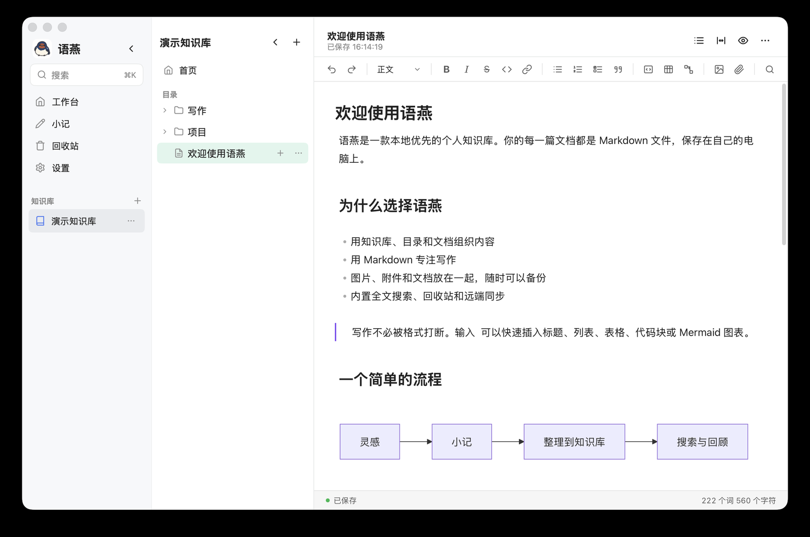
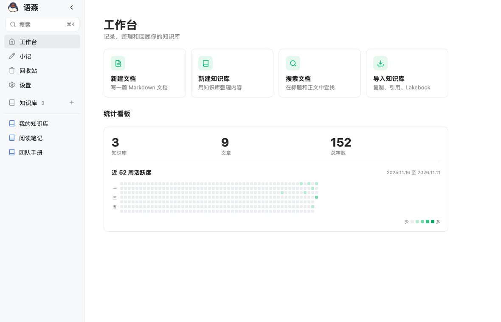
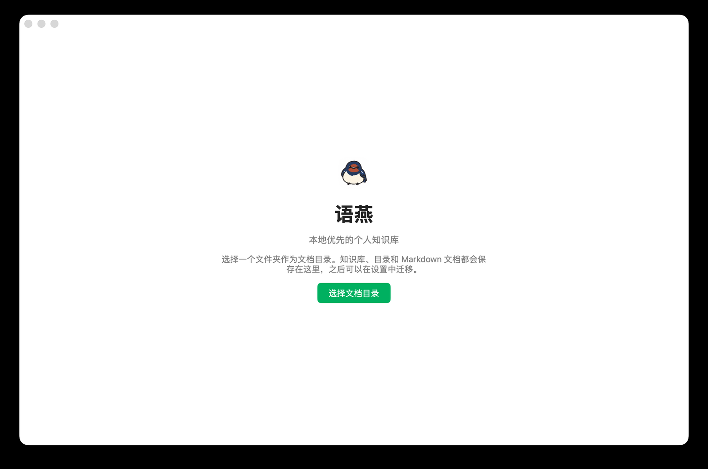

# 语燕（Swift）

> 本地优先的 Markdown 个人知识库，用 Go 和 [MyGo](https://github.com/egoist/mygo) 构建的桌面应用。

语燕把知识库式的内容管理和 Markdown 写作放在一起：知识库、目录、文档都在本地，正文是普通的 `.md` 文件，图片和附件跟着知识库走。没有账号、没有云端锁定，也不需要 Electron。



**快速导航：** [快速开始](#快速开始) · [功能](#功能) · [安装](#安装与运行) · [使用教程](docs/README.md) · [开发](#开发) · [常见问题](docs/15-faq.md)

## 为什么是语燕

- **本地优先，格式开放**：一篇文档就是一个 Markdown 文件；停用语燕后，仍可用任何编辑器打开。
- **知识库 + 目录树**：用知识库和目录管理多个主题；文档也可以有子文档，适合「主文档 + 补充材料」。
- **舒服的中文写作**：实时预览、大纲、宽窄模式、查找替换、任务列表、代码块、表格和 Mermaid。
- **该有的都有**：全局搜索、回收站、图片/附件管理、Lakebook 归档导入、Markdown/PDF/Word 导出。
- **可控的远端备份**：把文档目录单向镜像到 S3、NFS 或 SMB，适合 NAS 和对象存储用户。
- **可撤回的公开分享**：把一篇文档导出成 PDF，生成带有效期的链接，到期自动失效，也可以随时撤销。
- **纯 Go 桌面应用**：核心逻辑用 Go 编写，界面由 MyGo 原生渲染，文档编辑区使用系统 WebView；不依赖 Electron。
- **隐私友好**：默认离线，不含遥测；诊断日志只保存在本机，仅保留三天。

## 功能

| 功能 | 说明 | 教程 |
| --- | --- | --- |
| 知识库管理 | 全部知识库页、常用固定、新建/重命名/导出/删除；引用外部文件夹作为可读写的外部知识库 | [知识库管理](docs/03-knowledge-bases.md) |
| 阅读记忆 | 每个知识库分别记住上次打开的文档和滚动位置，再次进入时恢复 | [知识库管理](docs/03-knowledge-bases.md#3-打开知识库) |
| 目录与文档树 | 目录/分组、拖放、复制粘贴、置顶、移出、子文档；最多 4 级 | [目录与文档树](docs/04-tree-and-documents.md) |
| Markdown 写作 | 实时预览、标题、列表、任务、引用、代码块、表格、图片、附件、Mermaid；代码围栏成对删除，预览模式禁止剪切修改 | [编辑文档](docs/05-editing.md) / [Markdown 与内容块](docs/06-markdown-and-blocks.md) |
| 小记 | 不属于任何知识库的速记，之后可保存到知识库 | [小记](docs/07-quick-note.md) |
| 全局搜索 | 在标题和正文中搜索，可限定全部知识库、某个知识库或当前资源 | [搜索](docs/08-search.md) |
| 回收站 | 还原、彻底删除、清空；清理不再被引用的图片和附件 | [回收站](docs/09-trash.md) |
| 导入 | 复制导入 Markdown 文件夹、引用外部知识库、Lakebook 归档、单篇 md/txt/docx | [导入](docs/10-import.md) |
| 导出 | 文档 Markdown（含图片）ZIP、PDF、Word，整库 ZIP | [导出](docs/11-export.md) |
| 远端同步 | S3 / NFS / SMB 单向镜像；自动或手动；回收站删除后同步远端 | [远端同步](docs/12-remote-sync.md) |
| 公开分享 | 把文档导出成 PDF 上传到分享桶，生成 1/3/7 天或永久的链接 | [远端同步](docs/12-remote-sync.md#11-分享文档pdf) |
| 页面设置 | 全局默认行距、字号和打开模式（编辑/阅读），每篇文档可单独覆盖行距字号；不改写 Markdown | [编辑文档](docs/05-editing.md) |
| 诊断日志 | 本机日志、三天保留、导出 ZIP 排错 | [设置与数据](docs/13-settings-and-data.md) |
| 后台运行 | 关闭窗口后驻留菜单栏/通知区域，后台继续同步；从托盘真正退出 | [设置与数据](docs/13-settings-and-data.md#11-关闭窗口后台运行与退出) |

### 界面预览





## 快速开始

1. **选择文档目录**：首次启动选择一个文件夹，语燕把知识库和文档保存在这里；之后可在设置中迁移。
2. **新建第一篇文档**：点击工作台的「新建文档」，在弹窗里同时为知识库和第一篇文档命名；也可以先点击侧栏「知识库」右侧 `+` 新建知识库。
3. **开始写作**：直接输入正文；输入 `/` 插入标题、列表、代码块、表格或 Mermaid。
4. **查找内容**：按 `⌘K`（Windows/Linux 为 `Ctrl+K`）搜索全部知识库。

不需要点保存：停止输入约 0.6 秒后，文档会自动写入磁盘。

## 安装与运行

### 使用打包好的应用

如果你拿到的是构建产物：

- **macOS**：打开 `语燕.app`，或挂载 `.dmg` 后拖入「应用程序」。
- **Windows**：运行 `语燕.exe`，或运行安装程序。
- **Linux**：使用项目提供的包或可执行文件。

如果项目发布页提供了安装包，优先从发布页下载对应平台的版本。首次打开若被系统拦截，请确认来源可信后在系统设置中允许运行。

### 从源码运行

需要 Go 1.27.3 或更新版本：

```sh
git clone https://github.com/JHJMK/swift.git
cd swift

# 直接运行
go run .

# 开发模式：改 Go 代码后自动重启
make dev
```

### 自行打包

```sh
# 当前平台
make build

# 指定平台
make build PLATFORM=darwin/arm64
make build PLATFORM=windows/amd64
```

产物输出到 `build/`。打包后的应用包含文档编辑器的前端资源，普通使用不需要 Node.js。

> **提示**：只有修改 `web/editor/` 下的编辑器前端时，才需要 Node.js；Go 代码和文档不需要。

## 数据在哪里

语燕把内容保存在你选择的**文档目录**中：

```text
文档目录/
├── 知识库/
│   ├── 文档.md
│   ├── 文档/            ← 这篇文档的子文档
│   └── .assets/         ← 图片和附件
├── 另一个知识库/
└── .swift/              ← 回收站、小记、排序、同步清单
```

- 正文是标准 Markdown `.md`；
- 图片和附件在知识库的 `.assets/`；
- 回收站、小记和排序在 `.swift/`，不要手动删除；
- 应用设置和日志在系统配置目录的 `Swift/` 下，和文档目录分开存放。

备份时复制整个文档目录即可；需要保留设置（包括同步凭据）时，再单独备份 `config.json`。详见[设置与数据](docs/13-settings-and-data.md)。

> **隐私**：语燕不包含账号系统和遥测。只有远端同步、Lakebook 图片下载、打开外部链接或加载文档中的网络图片会联网；诊断日志只保存在本机，保留最近三天。

## 常用快捷键

| 快捷键 | 作用 |
| --- | --- |
| `⌘N` | 新建文档 |
| `⌘K` | 全局搜索 |
| `⌘,` | 设置 |
| `⌘F` | 当前文档查找/替换 |
| `⌘/` | 插入块 |
| `⇧⌘A` | 插入附件 |
| `/` | 在编辑器中打开块菜单 |
| `⌘B` / `⌘I` | 加粗 / 斜体 |
| `⇧⌘K` | 插入链接 |
| `⌘1`–`⌘6` / `⌘0` | 标题 / 正文 |
| `⇧⌘7` / `⇧⌘8` / `⇧⌘9` | 有序 / 无序 / 任务列表 |

Windows 和 Linux 上把 `⌘` 换成 `Ctrl`。完整列表见[快捷键与技巧](docs/14-shortcuts.md)。

## 使用教程

完整的中文教程在 [`docs/`](docs/README.md)：

| 章节 | 内容 |
| --- | --- |
| [01 安装与首次启动](docs/01-getting-started.md) | 环境、安装、选择文档目录、第一篇文档 |
| [02 界面总览](docs/02-interface.md) | 侧栏、目录树、编辑器、弹窗和布局 |
| [03 知识库管理](docs/03-knowledge-bases.md) | 知识库的新建、重命名、导出、删除和外部引用 |
| [04 目录与文档树](docs/04-tree-and-documents.md) | 目录、文档、子文档、拖放、复制粘贴 |
| [05 编辑文档](docs/05-editing.md) | 标题、自动保存、工具栏、预览、大纲、查找、页面设置 |
| [06 Markdown 与内容块](docs/06-markdown-and-blocks.md) | 语法、代码块、表格、Mermaid、图片、附件 |
| [07 小记](docs/07-quick-note.md) | 速记、保存到知识库、与文档的区别 |
| [08 搜索](docs/08-search.md) | 全局搜索、范围、结果和查找的区别 |
| [09 回收站](docs/09-trash.md) | 还原、彻底删除、清空、资源清理 |
| [10 导入](docs/10-import.md) | Markdown 文件夹、外部知识库、Lakebook、Word、TXT |
| [11 导出](docs/11-export.md) | Markdown+图片、PDF、Word、整库 ZIP |
| [12 远端同步](docs/12-remote-sync.md) | S3/NFS/SMB、自动/手动、删除语义和限制 |
| [13 设置与数据](docs/13-settings-and-data.md) | 迁移、备份、配置/日志位置、隐私 |
| [14 快捷键与技巧](docs/14-shortcuts.md) | 快捷键、斜杠命令、鼠标操作和效率技巧 |
| [15 常见问题](docs/15-faq.md) | 安装、写作、文件、搜索、导入导出、同步排错 |

## 开发

### 技术栈

- **语言**：Go 1.27.3+，无 cgo。
- **桌面框架**：[MyGo](https://github.com/egoist/mygo) 0.8.3，原生 UI + 系统 WebView。
- **文档编辑器**：TypeScript + CodeMirror 6 + Vite，构建后嵌入 Go 二进制。
- **图表**：Mermaid（Web 编辑器内置）。
- **导入/导出**：Lakebook 归档解析、Markdown、DOCX、PDF。
- **远端**：自行实现的 S3 Signature V4，以及 NFS/SMB 挂载目录。

### 项目结构

```text
main.go
internal/
├── app/          # MyGo 窗口、菜单、视图、编辑器桥接、导入导出、同步
├── vault/        # 文档目录：树、读写、资源、回收站、搜索、外部知识库
├── remote/       # S3 / NFS / SMB 单向镜像
├── lakebook/     # Lakebook 归档解析与 HTML→Markdown
└── markdown/     # 图片/链接引用重写
web/editor/       # CodeMirror 编辑器源码（构建到 internal/app/webassets）
docs/             # 使用教程与设计文档
```

### 构建与测试

```sh
make dev      # 开发模式，自动重启
make build    # 打包
make test     # Go 测试
make vet      # go vet + mygo vet
make check    # 格式、vet、测试
```

编辑器前端：

```sh
cd web/editor
npm install
npm run build   # 输出到 internal/app/webassets
npm run check   # TypeScript 类型检查
npm test        # 前端测试
```

> 构建后的 `internal/app/webassets` 是生成目录，不要手工修改；改 `web/editor/src` 后重新构建。

### 设计文档

部分功能的设计和实现计划保留在 [`docs/superpowers/`](docs/superpowers/)：

- [Lakebook 归档导入设计](docs/superpowers/specs/2026-11-07-lakebook-import-design.md)
- [可调整侧栏宽度设计](docs/superpowers/specs/2026-11-08-resizable-panels-design.md)
- [本地诊断日志设计](docs/superpowers/specs/2026-11-09-local-diagnostics-logging-design.md)

## 已知边界

- **远端同步是单向镜像**，不是多端双向同步，也没有冲突合并；
- **没有版本历史**；误删/覆盖依赖回收站、备份或外部工具；
- **没有移动端**、多人协作、评论或权限系统；
- **不是完整的双链笔记工具**：提示块、块引用、数据库视图、白板、数学公式等不支持；
- **外部知识库是可读写的活引用**，编辑、重命名、删除会直接作用在原文件夹；它不参与远端同步；需要独立副本时请复制导入；
- **跨层级移动文档**时，正文中的相对图片链接不会自动重写；若图片失效，需要重新插入或修正路径；
- **目录树最多 4 级**；更深的磁盘内容不会显示；
- **PDF/Word 导出是转换稿**，复杂表格和嵌入内容可能与页面不同，Markdown 最保真；
- **没有应用级加密**；请使用系统磁盘加密和受保护的账户；
- **单窗口、单文档编辑**；没有多标签页；
- **浅色主题**，暂不支持深色模式切换。

这些边界在[常见问题](docs/15-faq.md)中有更具体的说明。

## 许可证

本项目使用 [Apache License 2.0](LICENSE)。

## 反馈

- 提交 Issue：<https://github.com/JHJMK/swift/issues>
- 遇到应用或编辑器问题，请先在设置 > 诊断日志中导出最近三天日志，并附上系统、版本和复现步骤。

如果语燕对你有帮助，欢迎 Star 项目或把它推荐给需要本地知识库的人。
