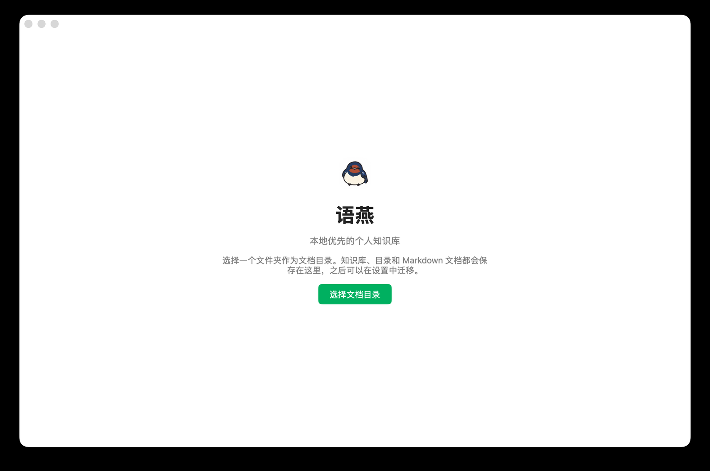

# 安装与首次启动

[返回教程目录](README.md) · [返回项目主页](../README.md)

本章从零开始：准备语燕、选择文档目录、建立第一个知识库，并写下第一篇文档。完成后，你的文档会以普通 Markdown 文件的形式保存在自己的电脑上。

## 1. 运行环境

语燕是一个桌面应用，不依赖浏览器打开，也不需要登录账号。

| 项目 | 要求 |
| --- | --- |
| 操作系统 | macOS、Windows、Linux 桌面系统 |
| 系统 WebView | macOS 使用 WKWebView，Windows 使用 WebView2，Linux 使用 WebKitGTK。系统缺少 WebView 时，语燕会尝试回退到内置的原生编辑器 |
| 磁盘 | 文档本身占用很小；图片、附件和 Mermaid 渲染缓存会随使用增长 |
| 网络 | 日常写作完全离线。只有远端同步、导入 Lakebook 的远程图片、打开外部链接时会联网 |

> **提示**：语燕的文档是本地 Markdown 文件，不依赖语燕服务器。即使以后不再使用语燕，也可以用任何 Markdown 编辑器继续打开它们。

## 2. 获取并安装语燕

### 2.1 使用已有的安装包

如果项目发布页或同事提供了安装包：

- **macOS**：打开 `.dmg`，把「语燕」拖进「应用程序」；或者直接解压得到 `.app` 后双击。
- **Windows**：运行 `语燕.exe`，或运行安装程序并按照提示完成安装。
- **Linux**：使用项目提供的包或可执行文件；如果你在自行构建，见下一节。

首次打开时，macOS 可能提示“无法验证开发者”，Windows 可能弹出 SmartScreen 提示。确认文件来源可信后，可以在系统设置中允许打开。

### 2.2 从源码运行

如果你拿到的是源码仓库：

```sh
# 需要 Go 1.27.3 或更新版本
go run .

# 或者使用项目自带的 MyGo 工具，开发模式会在改代码后自动重启
make dev
```

项目使用 `go.mod` 里的工具依赖来调用 MyGo，所以也可以直接执行：

```sh
go tool mygo dev
```

### 2.3 自行打包

打包输出在 `build/` 目录：

```sh
# 当前平台
make build

# 指定平台
make build PLATFORM=darwin/arm64
make build PLATFORM=windows/amd64
```

打包后的 macOS 版本是 `.app`（以及可选的 `.dmg`），Windows 版本是 `.exe` 和安装程序。macOS 上如果要在其他电脑运行，可能还需要签名和公证；这属于发布流程，不影响本地开发使用。

> **提示**：只有修改 `web/editor/` 下的编辑器前端时，才需要 Node.js 和 `npm install`。日常使用或仅修改 Go 代码时不需要。

## 3. 第一次启动：选择文档目录

第一次启动会看到欢迎页：



点击「选择文档目录」，选择一个文件夹。这个文件夹就是语燕的**文档目录**（也是通常说的“工作区”）。

选择时注意：

- 文档目录可以是空文件夹，也可以已经包含以前用其他工具整理的文件夹。
- **文档目录顶层的每一个文件夹会被视为一个知识库。** 直接放在文档目录根部的 `.md` 文件不会出现在语燕的文件树中；请把文档放进某个顶层文件夹，或用「导入」功能导入。
- 语燕会在文档目录里创建隐藏的 `.swift/` 元数据文件夹，用来保存排序、最近打开、回收站、小记等信息。不要手动修改或删除它。
- 之后可以在「设置」中更改文档目录并迁移全部内容，不必重新选择。

选定后，语燕会立即进入工作台。如果没有知识库，可以先创建一个；也可以直接点「新建文档」，语燕会自动创建默认的「我的知识库」。

## 4. 五分钟完成第一篇文档

1. 点击侧栏「知识库」右侧的 `+`，选择「新建知识库」。
2. 输入名称，例如「工作笔记」，点击「创建」。
3. 语燕会打开这个知识库。点击知识库标题右侧的 `+`，选择「新建文档」。
4. 新文档的标题会自动获得焦点。输入标题，例如「开始」，按 `Enter` 或点击正文区域。
5. 在正文中直接输入内容。输入 `/` 可以插入标题、列表、代码块等块类型。
6. 不需要点保存。停止输入约 0.6 秒后，语燕会自动保存，右上角的状态会显示「已保存」。

完成后，你的文档目录大致是：

```text
你的文档目录/
├── 工作笔记/
│   └── 开始.md
└── .swift/
    ├── order.json
    ├── recent.json
    └── ...
```

## 5. 数据放在哪里

- **正文**：文档目录中的 `.md` 文件。
- **图片和附件**：每个知识库下的 `.assets/` 文件夹。
- **回收站、小记、排序、最近打开、同步记录**：文档目录下的 `.swift/`。
- **应用设置**：系统配置目录中的 `Swift/config.json`，与文档目录分开保存，因此你可以移动文档目录。
- **诊断日志**：系统配置目录中的 `Swift/logs/`，只保留最近三天。

各系统的具体路径、备份方法和迁移步骤见[设置与数据](13-settings-and-data.md)。

## 6. 再次启动

再次打开语燕时，会自动使用上次选择的文档目录，并恢复窗口大小，但不会自动打开上次的文档；工作台的「最近打开」会列出最近编辑过的文档，点击即可继续。

如果启动后仍然看到欢迎页，通常说明：

- 配置文件被删除；
- 配置文件中的文档目录路径已不可用；
- 文档目录在移动硬盘或网络位置上，暂时没有挂载。

重新选择文档目录即可；原有文件不会被删除。

## 7. 更新与卸载

- **更新**：用新版本的应用替换旧版本即可。文档和设置都在用户目录中，不会因替换应用而丢失。
- **卸载**：删除应用本身不会删除文档目录、配置和日志。若确定不再使用，可以另外删除文档目录、`Swift/config.json` 和 `Swift/logs/`。
- **不要**为了“清理”而删除文档目录中的 `.swift/`：回收站、小记、最近打开和排序信息都在里面。

## 下一步

- 认识界面：[界面总览](02-interface.md)
- 管理知识库：[知识库管理](03-knowledge-bases.md)
- 开始写作：[编辑文档](05-editing.md)
