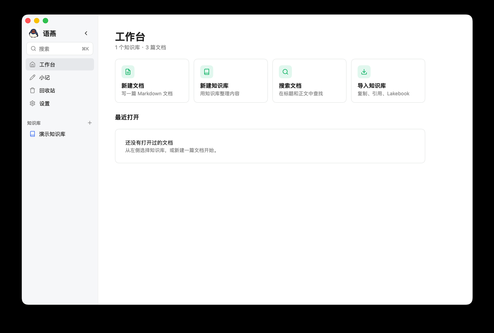

# 界面总览

[返回教程目录](README.md) · [返回项目主页](../README.md)

语燕的主窗口由三列组成：左侧是全局侧栏，中间是当前知识库的目录树，右侧是工作台或文档页面。理解这三列各自负责什么，后面的操作会容易很多。

## 1. 主窗口



| 区域 | 位置 | 作用 |
| --- | --- | --- |
| 全局侧栏 | 最左侧，浅灰色 | 搜索、工作台、小记、回收站、设置，以及知识库列表 |
| 知识库目录树 | 中间，宽度可调 | 当前知识库的「首页」和文档树；右侧边缘可拖动改宽度 |
| 内容区 | 右侧，白色 | 工作台、知识库首页、目录页或文档编辑页 |

三列不是永远都在：

- 没有选中知识库时，中间的知识库目录树不显示，内容区直接显示工作台。
- 收起全局侧栏后，左列变成只显示图标的窄条（侧栏轨道）。
- 收起知识库目录树后，左列全部隐藏，内容区占满窗口；窗口左侧会出现一个「展开目录」小按钮。
- 窄窗口下可以用侧栏和目录树各自的收起按钮腾出写作空间。

## 2. 全局侧栏

全局侧栏从上到下依次是：

- 应用图标和「语燕」名称。
- **搜索**：点击打开搜索窗口，也可以按 `⌘K`。
- **工作台**：回到全局首页。
- **小记**：打开不归属任何知识库的速记。
- **回收站**：查看和还原删除的内容。
- **设置**：文档目录、远端同步、诊断日志等。
- **知识库**：列出全部知识库。右侧的 `+` 用于新建知识库或导入知识库。
- **收起侧栏**：把侧栏折叠成图标轨道。
- 底部是设置入口（折叠后仍在轨道底部）。

### 折叠成图标轨道

点击标题栏右侧的收起按钮，侧栏会变成 56px 宽的图标轨道：

- 每个图标悬停时会显示名称。
- 点击书本图标或把指针移到它上面，会展开知识库列表浮层。
- 点击顶部的展开按钮恢复完整侧栏。

折叠状态是本次运行的界面状态，不会写入文档；重启后恢复为展开。

## 3. 知识库目录树

选中任意知识库后，中间会出现它的目录树：

- **知识库标题**：显示当前知识库名称。
- **收起目录**：隐藏整个目录树，让编辑区变宽。
- **`+`（新建）**：在当前知识库中新建文档、新建目录、导入文档、粘贴资源、重命名知识库。
- **首页**：打开知识库首页，而不是直接打开某篇文档。
- **目录**：知识库的文档树。
- **树的每一行**：单击打开；悬停时出现「添加」和「更多操作」；右键打开同一个「更多操作」菜单；上下拖动可以调整同级顺序。
- **右侧边缘**：拖动可以调整目录树宽度。默认 220px，范围 180–360px，松开后自动保存。

### 树上的图标和状态

| 图标 / 状态 | 含义 |
| --- | --- |
| 书本 | 知识库 |
| 文件夹 | 目录 / 分组 |
| 文件 | 文档 |
| 右向箭头 | 该节点有子项，当前折叠；点击展开 |
| 下向箭头 | 该节点已展开；点击折叠 |
| 绿色底 | 当前选中的节点 |
| 行尾的 `+` | 在当前节点下新建文档、分组或导入文档 |
| 行尾的 `…` | 重命名、复制、粘贴、移动、导出、删除等 |

> **提示**：文档也可以有子文档。树里文档下方的子项，实际保存在与文档同名的文件夹中；磁盘结构详见[目录与文档树](04-tree-and-documents.md)。

## 4. 内容区

内容区会显示四种页面之一：

1. **工作台**：没有选中任何知识库或文档时。
2. **知识库首页 / 目录页**：选中知识库或目录、但没有打开文档时。
3. **文档编辑页**：打开一篇文档时。
4. **欢迎页**：尚未选择文档目录时。

### 4.1 工作台

工作台包含：

- 当前内容统计：`N 个知识库 · M 篇文档`。
- 四张快捷卡片：
  - **新建文档**：先选择存放位置，再创建。
  - **新建知识库**：创建一个新的顶层文件夹。
  - **搜索文档**：打开全局搜索。
  - **导入知识库**：展开「复制导入知识库」「引用外部知识库」「导入 Lakebook」。
- **最近打开**：按打开时间列出最近 20 篇文档，点击继续编辑；右侧显示所属路径和时间。

### 4.2 知识库首页 / 目录页

选中知识库并点击「首页」，或选中一个目录时，内容区显示：

- 图标、名称和相对路径。
- 「新建文档」「新建目录」按钮。
- 「更多」菜单：重命名、在 Finder 中显示、删除；外部知识库根节点则显示「移除外部知识库」。
- 当前层级的子项列表：目录显示条目数，文档显示「Markdown」；点击打开，点击空状态提示中的操作也可以新建。

知识库首页和打开某篇文档是两种状态：点击侧栏中的知识库名称时，语燕默认打开该知识库里的第一篇文档；想只看知识库结构时，点击目录树中的「首页」。

### 4.3 文档编辑页

文档页从上到下分为：

- **顶部信息栏**：文档标题、保存状态、外部引用标记；右侧是「大纲」「宽窄模式」「预览」「更多」。
- **格式工具栏**：撤销、重做、段落样式、加粗、斜体、删除线、行内代码、链接、列表、代码块、表格、Mermaid、图片、附件、查找。
- **正文区**：页面标题（可直接编辑）和 Markdown 正文。
- **底部状态栏**：词数、字符数、保存状态；回退到原生编辑器时，进入代码块还会显示快捷键提示。

文档页的详细操作见[编辑文档](05-editing.md)。

## 5. 弹窗、菜单和提示

语燕的弹窗都覆盖在内容区上方，背景会变暗：

| 弹窗 | 用途 |
| --- | --- |
| 新建 / 重命名 / 保存到 | 输入一行名称，回车确认 |
| 删除确认 / 迁移确认 / 清空回收站 | 需要再次确认的危险操作 |
| 新建文档位置 / 小记保存到 | 在知识库树中选择一个位置 |
| 设置 | 文档目录、文档显示默认值、远端同步、诊断日志、内容统计 |
| 页面设置 | 全局默认行距/字号与当前文档的覆盖设置 |
| 搜索 | 全局搜索标题和正文 |
| 回收站 | 还原、彻底删除、清空 |
| 同步结果 | 「立即同步」完成后的结果摘要 |

另外还有三种轻量提示：

- **错误横幅**：出现在内容区顶部，红色背景，右侧「关闭」。
- **Toast**：出现在页面上方中间的短提示，例如「复制成功」「文档已从磁盘更新」「导入完成…」。
- **状态文字**：例如「已保存 15:04:05」「自动保存中…」「预览」。

## 6. 调整布局

### 6.1 侧栏和目录树

- 全局侧栏收起后变成图标轨道；点击顶部按钮恢复。
- 知识库目录树用「收起目录」按钮隐藏；隐藏后窗口左边缘会出现「展开目录」按钮。
- 两个收起状态互不影响：可以先收起侧栏，再收起目录树，得到最大的写作区域。

### 6.2 拖动改变宽度

- **知识库目录树右边缘**：左右拖动改变宽度。
- **文档大纲左边缘**：在打开大纲时拖动，改变大纲宽度。

宽度在拖动结束时保存到配置，下次启动继续使用；拖动过程中，文字和布局会实时重排。

### 6.3 文档页的宽窄模式

文档页右上角有一个「宽窄模式」按钮：

- 宽模式：正文区域更宽，适合大屏、代码和表格。
- 窄模式：正文限制在更适合阅读的宽度，两侧留白更多。

切换立即生效，不会改变 Markdown 内容。

## 7. 阅读状态与外部引用

- **普通文档**：标题栏显示保存时间和「已保存」；正文可编辑。
- **外部知识库文档**：状态后追加「· 外部引用」，正文仍可编辑，格式工具栏可用；保存会直接写回原文件夹。详见[知识库管理](03-knowledge-bases.md#7-外部知识库引用已有文件夹)。
- **小记**：状态显示「小记 · …」，顶部只有「保存到」按钮，没有大纲、导出等文档操作。
- **预览模式**：状态显示「预览」，工具栏隐藏，正文不可编辑；再点一次铅笔图标回到编辑。

## 8. 导航关系

```text
工作台
├── 点击知识库 ──→ 打开该知识库的第一篇文档
│                 ├── 点击「首页」──→ 知识库首页
│                 └── 点击目录 / 文档 ──→ 目录页 / 文档页
├── 小记 ──→ 小记页
├── 回收站 ──→ 回收站弹窗
├── 设置 ──→ 设置弹窗
└── 搜索 ──→ 搜索结果 ──→ 对应文档
```

语燕没有浏览器的前进/后退按钮，也没有多标签页。切换文档时，当前文档会自动保存，然后打开目标文档。

## 下一步

- 管理知识库：[知识库管理](03-knowledge-bases.md)
- 整理目录和文档：[目录与文档树](04-tree-and-documents.md)
- 开始编辑：[编辑文档](05-editing.md)
