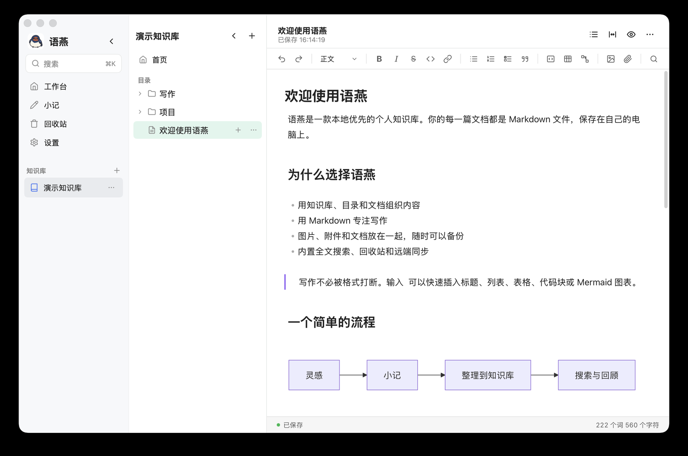

# 编辑文档

[返回教程目录](README.md) · [返回项目主页](../README.md)

打开一篇文档后，语燕显示一个简洁的 Markdown 编辑页面：标题、格式工具栏、实时预览正文和底部字数统计。

## 1. 打开文档

可以通过以下方式打开：

- 在目录树中点击文档；
- 在工作台「最近打开」中点击；
- 在搜索结果中点击；
- 在文档页的大纲或链接中跳转。

一次只打开一篇文档。切换文档时，语燕会先自动保存当前文档，再打开目标文档，不会丢失输入。

## 2. 页面结构

| 区域 | 内容 |
| --- | --- |
| 顶部信息栏 | 当前标题、保存状态、外部引用标记；右侧为「大纲」「宽窄模式」「预览」「更多」 |
| 格式工具栏 | 撤销/重做、段落样式、字符格式、列表、代码块、表格、Mermaid、图片、附件、查找 |
| 正文 | 可直接编辑的页面标题和 Markdown 正文 |
| 底部状态栏 | 词数、字符数、保存状态；回退到原生编辑器时，代码块内还会显示快捷键提示 |

空文档的正文会显示「直接输入正文，也可选择一个模板：」的占位提示；插入标题、列表、引用或代码块后，提示自动消失。

## 3. 修改标题

页面顶部的大标题是文档标题，不是正文的一部分。它对应磁盘上的文件名。

- 点击标题进入编辑，输入后按 `Enter` 或点击正文，标题立即生效。
- 按 `Esc` 放弃这次输入，标题恢复原值。
- 按 `↓` 可以从标题进入正文；在正文开头按 `↑` 回到标题。
- 标题为空时不会改成空文件名；会保留原标题。
- 文件名中的非法字符会被替换；重名会自动加「 2」。
- 重命名会同步更新目录树、窗口标题和文档路径对应的页面设置。

> **提示**：文档标题已经在页面顶部显示一次，正文里不必再写一个 `# 标题`。如果你希望导出后也有 H1，可以保留正文 H1，但要接受页面里出现两个标题。

## 4. 自动保存

语燕没有「保存」按钮，编辑内容会自动保存：

1. 你输入时，页面把 Markdown 交给 Go 端；
2. 停止输入约 0.6 秒后，语燕把内容原子写入 `.md` 文件；
3. 顶部状态从「自动保存中…」变为「已保存 HH:MM:SS」；
4. 保存失败时状态显示「保存失败」，并在内容区显示错误横幅。

关闭窗口或切换文档时，语燕会立即冲刷尚未保存的内容。即使如此，在重要操作前仍建议确认状态为「已保存」。

> **注意**：自动保存是“保存到磁盘”，不是“版本历史”。误删或覆盖后，语燕没有内置的撤销历史；请使用回收站、备份或系统的文件历史功能。

## 5. 格式工具栏

工具栏从左到右：

| 按钮 | 作用 | 快捷键（Web 编辑器） |
| --- | --- | --- |
| 撤销 / 重做 | 撤销或重做编辑操作 | `⌘Z` / `⇧⌘Z` |
| 段落样式 | 正文、标题 1–6 | `⌘0` 正文，`⌘1`–`⌘6` 标题 |
| B | 加粗 | `⌘B` |
| I | 斜体 | `⌘I` |
| S | 删除线 | `⇧⌘X` |
| `<>` | 行内代码 | `⌘E` |
| 链接 | 给选中文字加链接 | `⇧⌘K` |
| 无序列表 | 圆点列表 | `⇧⌘8` |
| 有序列表 | 编号列表 | `⇧⌘7` |
| 任务列表 | 可勾选列表 | `⇧⌘9` |
| 引用 | 引用块 | — |
| 代码块 | 插入围栏代码块 | — |
| 表格 | 插入两列表格模板 | — |
| Mermaid | 插入 Mermaid 图表模板 | — |
| 图片 | 从文件插入图片 | — |
| 附件 | 从文件插入附件 | — |
| 查找 | 打开查找/替换面板 | `⌘F` |

Windows 和 Linux 上，`⌘` 对应 `Ctrl`。如果工具栏按钮呈灰色，通常是因为当前处于预览模式。

## 6. 斜杠命令

在正文中输入 `/`，会打开块类型菜单：

1. 在行首，或在一个空格后输入 `/`；
2. 继续输入关键词可以过滤，例如 `/代码`、`/表`；
3. 用 `↑` / `↓` 选择，`Enter` 执行，`Esc` 关闭；
4. 选择后，`/` 和输入的关键词会被移除，再插入对应的 Markdown 块。

可用命令：

| 命令 | 插入内容 |
| --- | --- |
| 标题 1 / 2 / 3 | `#`、`##`、`###` |
| 无序列表 | `- ` |
| 有序列表 | `1. ` |
| 任务列表 | `- [ ] ` |
| 引用 | `> ` |
| 代码块 | 围栏代码块 |
| 表格 | 两列表格模板 |
| Mermaid 图表 | Mermaid 代码块模板 |
| 图片 | 打开文件选择器并插入图片 |
| 附件 | 打开文件选择器并插入附件 |
| 分割线 | `---` |

以下情况不会触发斜杠菜单：

- 光标在代码块中；
- `/` 跟在 `:`、`/`、`\` 后面，例如网址中的 `https://`；
- 当前处于预览模式。

也可以使用菜单栏 插入 > 插入块…（`⌘/`）打开同一类菜单。

## 7. 实时预览与预览模式

### 7.1 实时预览

正文默认采用实时预览：

- 光标不在某一行时，标题的 `#`、加粗的 `**` 等 Markdown 标记会隐藏，直接显示排版结果；
- 光标进入某一行时，该行显示 Markdown 源码，方便精确修改；
- 图片、表格、任务复选框、Mermaid 图表在非编辑行显示为渲染结果；
- 点击图片、表格或图表，可以把光标移回其 Markdown 源码。

这不是“左边源码、右边预览”的分栏模式；你始终在同一个页面中写作。

### 7.2 预览模式

顶部右侧的眼睛图标切换到预览模式：

- 隐藏格式工具栏；
- 正文完全渲染，不可编辑；
- 状态显示「预览」；
- 再点铅笔图标回到编辑。

预览模式适合检查最终排版或演示，不会修改文档。

## 8. 大纲

点击顶部「大纲」按钮，右侧出现大纲栏：

- 列出正文中的 H1–H6 标题；
- 当前光标所在的章节会高亮；
- 点击标题跳转到对应位置；
- 没有标题时显示「标题会显示在这里」。

大纲左边缘可以左右拖动调整宽度，默认 240px，范围 180–420px，松开后保存。收起大纲后，正文区域会自动变宽。

> **提示**：大纲只识别 Markdown 标题（`#` 到 `######`），不识别加粗或纯文本行。先给文档加标题，再使用大纲。

## 9. 查找与替换

按 `⌘F` 或点击工具栏的查找按钮，打开页面右上方的查找面板：

- 输入要查找的文字，匹配项会高亮；
- 「下一个」「上一个」切换匹配；
- 勾选「区分大小写」「正则」「全词」改变匹配规则；
- 在替换输入框中输入替换内容，使用「替换」「全部替换」；
- 按 `Esc` 或点击关闭按钮退出。

查找范围是**当前文档**。如果要在全部知识库中查找，请使用全局搜索（`⌘K`），两者不要混淆：

| | 查找（`⌘F`） | 搜索（`⌘K`） |
| --- | --- | --- |
| 范围 | 当前文档 | 全部知识库或指定范围 |
| 结果 | 页面内高亮 | 结果列表 |
| 替换 | 支持 | 不支持 |
| 用途 | 校对当前文档 | 找一篇文档 |

## 10. 页面设置

点击顶部「更多」> 「页面设置…」，可以调整当前文档的显示方式：

- **行间距**：紧凑（1.5）、标准（1.75）、宽松（2）。
- **默认字体大小**：14、15、16、18、20。

新文档默认跟随**全局设置**（在「设置 > 文档显示」中调整默认行距和字号）。调整行距或字号后，当前文档会保存一份单独设置，覆盖全局默认：

- 页面设置顶部会显示当前是「跟随全局默认」还是「使用单独设置」；
- 单独设置后，可以点「恢复为全局默认」重新跟随全局；
- 修改全局设置只影响没有单独设置的文档，已有单独设置的文档保持不变。

这些设置只影响页面显示，**不会改写 Markdown 正文**，也不会影响导出时的字体（导出使用自己的排版样式）。单独设置按文档路径保存在本机配置中，重新打开文档后生效；跟随全局的文档直接读取全局默认。

## 11. 字数与状态

底部状态栏显示：

- `X 个词 Y 个字符`：中文按字计数，英文和数字按词计数；字符数按 Unicode 字符统计。
- 保存状态：与顶部一致。
- 回退到原生编辑器时，进入代码块会在右侧提示「Enter 换行 · ⌘Enter 退出代码块」；默认的 Web 编辑器把代码块当作普通 Markdown 围栏编辑。

字数会随输入更新，可用于估算篇幅；它不是严格的字数统计工具（例如不区分中英文标点、代码和正文）。

## 12. 粘贴、拖放与链接

- **粘贴普通文本**：按原样插入。
- **粘贴网页或富文本**：转换为 Markdown，保留标题、列表、加粗、链接等常见格式。
- **粘贴图片**：复制图片后直接粘贴，图片会保存到知识库的 `.assets/`。
- **复制文字和图片**：在正文中选中文字和图片后复制，图片会以图片数据随富文本一起写入剪贴板，粘贴到聊天、Word 等工具时文字和图片都会保留。
- **拖入文件**：把图片或附件拖到正文，自动保存并插入链接。
- **粘贴 URL 到选中文字上**：自动变成 `[选中文字](URL)`。
- **粘贴并匹配样式**：使用菜单 编辑 > 粘贴并匹配样式，只插入纯文本，不带原网页的格式。
- **打开链接**：按住 `⌘`（Windows/Linux 为 `Ctrl`）点击正文中的链接。网页用系统浏览器打开，本地文件用默认应用打开。

详细语法和内容块见[Markdown 与内容块](06-markdown-and-blocks.md)。

## 13. 外部知识库文档

打开外部知识库中的文档时：

- 顶部状态显示「· 外部引用」；
- 正文仍然可以编辑，格式工具栏可用；
- 保存会直接写回**原文件夹**，不会在文档目录中创建副本；
- 重命名、删除会作用在原文件夹上；删除会进入语燕回收站，原文件从原文件夹移走；在外部知识库内部移动文档也会改变原路径；
- 图片、附件路径由原目录决定，语燕不会自动复制到文档目录的 `.assets/`。

如果你只想查看、不想修改原文件，请不要编辑，或先使用「复制导入知识库」创建一份独立的本地副本。

## 14. 与其他程序同时编辑

语燕会监视当前知识库的文件夹。当其他程序修改了正在打开的文档时：

- 如果本地没有未保存修改，页面自动更新，并提示「文档已从磁盘更新」；
- 如果本地有未保存修改，语燕保留本地内容，并提示「磁盘文件已更新，当前有未保存修改，已保留本地内容」；你可以继续编辑并保存，或先复制内容再决定；
- 如果文件在外部被删除，且本地没有未保存修改，语燕会关闭文档并提示；如果本地有修改，会保留编辑内容。

语燕自己保存后写回磁盘的变化不会触发这些提示，保存过程保持安静。

详见[设置与数据](13-settings-and-data.md#7-与-finder-和其他编辑器协作)。

## 15. 文档页的「更多」菜单

点击右上角 `…`：

- 导出 Markdown（含图片）
- 导出为 PDF
- Word (.docx)
- 页面设置…（全局默认或当前文档的覆盖设置）
- 在 Finder 中显示
- 删除

导出细节见[导出](11-export.md)，删除见[回收站](09-trash.md)。

## 16. 写作建议

- 用标题建立结构，大纲和导出都会受益。
- 不要手动输入大量空行来制造间距；用段落和标题即可。
- 图片和附件让语燕复制到 `.assets/`，不要引用桌面上的临时文件。
- 重要文档先确认「已保存」，再执行移动、删除或同步。
- 长文档可以用「宽窄模式」切换到窄栏，阅读更舒适。

## 下一步

- 学习 Markdown 和内容块：[Markdown 与内容块](06-markdown-and-blocks.md)
- 使用小记快速记录：[小记](07-quick-note.md)
- 查找内容：[搜索](08-search.md)
