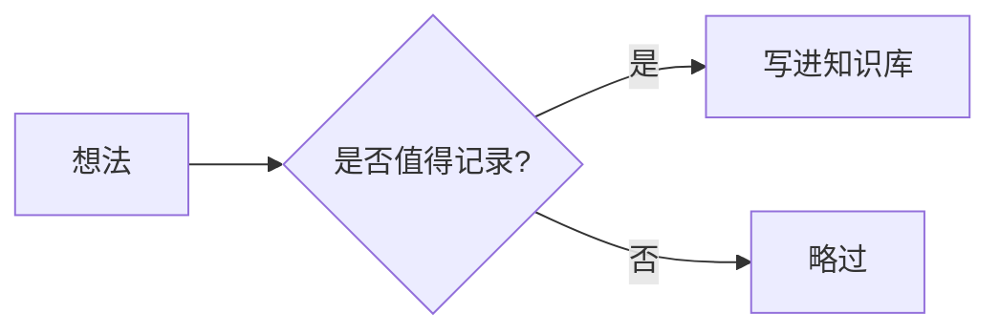

# Markdown 与内容块

[返回教程目录](README.md) · [返回项目主页](../README.md)

语燕的文档本质上就是 Markdown 文件。编辑器提供实时预览和工具栏，但最终写入磁盘的仍是纯文本 Markdown，因此你可以随时用其他工具打开、搜索或版本管理这些文件。

本章列出语燕支持的常用语法和内容块，以及一些容易踩坑的地方。

## 1. 整体支持范围

语燕的 Web 编辑器支持常用 Markdown 语法，并额外兼容少量双链写法：

- 标题、段落、换行；
- 加粗、斜体、删除线、高亮、行内代码；
- 有序列表、无序列表、任务列表、嵌套列表；
- 引用；
- 围栏代码块（默认 Web 编辑器含语言标注、标题和复制按钮）；
- 管道表格（含对齐）；
- 图片和附件；
- 链接、自动链接、`[[双链]]` 样式；
- 水平分割线；
- 少量行内 HTML 标签；
- Mermaid 图表。

语燕不是完整的双链笔记实现，也未提供插件、反向链接、白板、数据库视图等高级能力。详见[第 16 节](#16-不支持的写法)。

## 2. 标题

```markdown
# 一级标题
## 二级标题
### 三级标题
#### 四级标题
##### 五级标题
###### 六级标题
```

- 标题用于建立层级，会出现在右侧大纲中；
- 在非编辑行，`#` 号会隐藏，只显示渲染后的标题；
- 点击工具栏的「段落样式」可以在正文和 H1–H6 之间切换；
- 快捷键 `⌘1`–`⌘6` 设置标题，`⌘0` 恢复正文（Windows/Linux 用 `Ctrl`）。

> **提示**：文档标题已经显示在页面顶部。正文从 `##` 开始，通常比再从 `#` 开始更清爽。

## 3. 段落与换行

- 空行分隔段落。
- 单个换行在编辑器中也会显示为新行；导出为某些格式时，Markdown 段落规则可能把它合并。需要强制换行时，可以在行尾留两个空格，或使用 `<br>`。
- 不要用大量空行制造间距，使用标题和段落即可。

## 4. 行内格式

```markdown
**加粗**
*斜体*
~~删除线~~
==高亮==
`行内代码`
<u>下划线</u>
```

效果：

- **加粗**
- *斜体*
- ~~删除线~~
- ==高亮==
- `行内代码`
- <u>下划线</u>

工具栏和快捷键：

| 格式 | 快捷键 |
| --- | --- |
| 加粗 | `⌘B` / `Ctrl+B` |
| 斜体 | `⌘I` / `Ctrl+I` |
| 删除线 | `⇧⌘X` / `Ctrl+Shift+X` |
| 行内代码 | `⌘E` / `Ctrl+E` |
| 链接 | `⇧⌘K` / `Ctrl+Shift+K` |

再次使用同一格式可以取消；选中文字后使用会包裹选中内容。

## 5. 列表

### 5.1 无序列表

```markdown
- 第一项
- 第二项
  - 嵌套项
```

### 5.2 有序列表

```markdown
1. 第一步
2. 第二步
3. 第三步
```

- 点击某一项前面的数字，可以直接输入新的起始编号；这一项和它后面同级的有序项会一起重新编号。比如 `1 2 3 4 5`，把第 3 项改成 `1`，会变成 `1 2 1 2 3`。
- 选中多行后点击工具栏的「有序列表」，所有选中的行会一起变成有序列表；再点一次会一起取消。选中的行里混有普通段落、无序列表等时，也会统一转换为有序列表。

### 5.3 任务列表

```markdown
- [ ] 待办事项
- [x] 已完成事项
```

- 任务列表的复选框可以直接点击切换；
- 已勾选写为 `- [x]`，未勾选写为 `- [ ]`；
- 任务列表可以嵌套；
- 导出的 Markdown 保留 `[ ]` / `[x]`。

### 5.4 缩进

- 在列表项中按 `Tab` 增加缩进，按 `Shift+Tab` 减少缩进；
- 也可以使用工具栏的「增加缩进」「减少缩进」（原生编辑器提供）；
- 建议每一级使用两个空格，保持 Markdown 可读。

## 6. 引用

```markdown
> 这是一段引用。
>
> 引用可以有多段。
```

引用块左侧会显示一条竖线。引用中也可以放列表、链接和行内格式。

## 7. 代码块

### 7.1 基本写法

在三个反引号后写语言名：

````markdown
```go
package main

import "fmt"

func main() {
    fmt.Println("Hello")
}
```
````

编辑器会：

- 根据语言显示语法高亮；
- 在代码块右上角显示语言标签；
- 语言标签旁边是复制按钮；
- 在光标离开代码块时保持代码块样式，点击代码行进入编辑；
- 在行首连续输入三个反引号时，自动补全结束围栏；接着输入语言名后按 `Enter` 会进入代码正文，不会在围栏之间多出一行；
- 光标在代码块内时，`⌘A`（Windows/Linux 为 `Ctrl+A`）只选中代码块内的内容；在代码块外才是全选整篇文档。

> **回退说明**：上面这些代码块界面能力属于默认的 Web 编辑器。如果系统缺少 WebView、回退到原生编辑器，代码块会显示为普通等宽块，不显示语言标签、复制按钮和标题栏，也不会预览 Mermaid；语言和标题仍保存在 Markdown 围栏信息中，用 Web 编辑器或其他 Markdown 工具打开时仍然有效。

### 7.2 语言标注

````markdown
```sql
SELECT * FROM notes;
```

```bash
npm run build
```


````

常见语言都可以识别，例如 Go、JavaScript、TypeScript、Python、Shell、SQL、JSON、YAML、Rust、Java、C/C++、HTML、CSS 等。语言名只是标注和语法高亮的依据，不会执行代码。

### 7.3 代码块标题

可以在语言后写 `title="..."`：

````markdown
```go title="main.go"
package main
```
````

Web 编辑器的代码块顶部会优先显示 `main.go`，否则显示语言名。这个标题只用于展示。

### 7.4 在代码块里写代码块

如果代码内容本身包含三个反引号，外层请使用四个反引号：

````markdown
```go
fmt.Println("嵌套")
```
````

Markdown 会按相同字符和足够长度的围栏来配对；需要继续嵌套时，外层使用更多的反引号即可。

### 7.5 代码块中的编辑行为

- `Enter` 换行；
- Web 编辑器中用方向键正常移入、移出代码块；
- 回退到原生编辑器时，`⌘Enter`（Windows/Linux 为 `Ctrl+Enter`）可以退出代码块；
- 代码块内不触发斜杠菜单；
- 删除整个代码块：Web 编辑器可以直接选中围栏删除；原生回退编辑器选中代码后删除。

## 8. 表格

### 8.1 基本写法

```markdown
| 名称 | 说明 | 数量 |
| --- | --- | ---: |
| 苹果 | 水果 | 3 |
| 白菜 | 蔬菜 | 5 |
```

- 第一行是表头，第二行是分隔行；
- `---` 表示默认对齐，`:---` 左对齐，`---:` 右对齐，`:---:` 居中；
- 单元格中的 `|` 需要写成 `\|`；
- 编辑器会在光标离开表格时渲染成表格，点击表格可回到源码编辑；
- Markdown 表格不支持合并单元格、复杂嵌套或跨行。

### 8.2 在表格中写行内格式

单元格支持加粗、斜体、删除线、行内代码和链接。复杂内容建议拆成列表或单独段落。

### 8.3 导出注意

Markdown 导出会完整保留表格源码。PDF 和 Word 导出对表格的还原程度有限，复杂表格可能被展开为文本；需要高保真时优先导出 Markdown。详见[导出](11-export.md)。

## 9. Mermaid 图表

### 9.1 插入

- 工具栏的 Mermaid 按钮；
- 输入 `/` 选择「Mermaid 图表」；
- 直接写围栏代码块并标注 `mermaid`。

```markdown

```

### 9.2 支持的图

语燕内置完整的 Mermaid 渲染器，常见类型包括：

- 流程图 `flowchart` / `graph`
- 时序图 `sequenceDiagram`
- 类图 `classDiagram`
- 状态图 `stateDiagram`
- ER 图 `erDiagram`
- 甘特图 `gantt`
- 饼图 `pie`
- 旅程图 `journey`
- 思维导图 `mindmap`
- 时间线 `timeline`

具体语法以 [Mermaid 官方文档](https://mermaid.js.org/)为准。

### 9.3 查看与编辑

- 光标离开 Mermaid 代码块时，显示渲染后的图表；
- 点击图表回到源码编辑；
- 修改源码后，图表会重新渲染；
- 语法错误时，图表位置保留源码，方便修改；不会执行任意脚本（Mermaid 使用严格安全模式）。

> **提示**：Mermaid 预览由默认的 Web 编辑器提供。系统 WebView 不可用、回退到原生编辑器时，Mermaid 代码块只显示源码，语言标记仍会保留在 Markdown 中。

## 10. 图片

### 10.1 插入方式

- 工具栏「插入图片」；
- 斜杠命令「图片」；
- 菜单栏 插入 > 图片…；
- 把图片文件直接拖入正文；
- 复制图片后粘贴。

### 10.2 Markdown 写法

```markdown

```

- `![说明]` 是图片替代文本；
- 括号内是相对于当前文档的路径；
- 语燕会把导入或插入的图片复制到所在知识库的 `.assets/`，并用相对路径引用；
- 支持 PNG、JPEG、GIF、WebP、BMP 等常见格式；SVG 的显示取决于系统 WebView；
- 图片单独成行时显示为块级图片；夹在文字中时显示为行内图片；
- 点击图片回到它的 Markdown 源码；
- **右键图片**：直接把图片本身复制到系统剪贴板（可粘贴到聊天、文档或画图工具），复制的不是它的路径；
- **复制文字和图片**：选中一段同时包含文字和图片的内容复制时，图片会以图片数据嵌入富文本剪贴板；粘贴到聊天、Word、邮件等支持富文本的地方会同时得到文字和图片，纯文本目标只能得到文字。

### 10.3 从外部引用图片

- 网络图片可以写 `https://...`；
- 本地绝对路径或 `file://` 路径也可以写，但可移植性差，且系统 WebView 可能限制加载；
- 需要长期保存的图片，建议让语燕复制到 `.assets/`。

> **注意**：不要把 `.assets/` 中的文件单独移动或重命名；文档通过相对路径引用它们。需要移动图片时，重新插入或同步修改 Markdown 路径。

### 10.4 图片不显示时

1. 确认图片文件还在 `.assets/` 中；
2. 确认 Markdown 中的相对路径正确；
3. 如果文档被移动到不同层级，相对路径可能失效（见[目录与文档树](04-tree-and-documents.md#43-拖动)）；
4. 网络图片需要网络连接，且对方站点允许外链。

## 11. 附件

- 工具栏「插入附件」、斜杠命令「附件」、菜单栏 插入 > 附件…（`⇧⌘A`）；
- 选择一个任意类型的文件；
- 语燕把文件复制到知识库的 `.assets/`，并插入一个 Markdown 链接：

```markdown
[设计稿.pdf](.assets/1700000000000-设计稿.pdf)
```

- 按住 `⌘`（Windows/Linux 为 `Ctrl`）点击链接，用系统默认应用打开；
- 附件同样不要手动移动，否则链接会失效。

## 12. 链接

### 12.1 普通链接

```markdown
[语燕项目主页](https://github.com/JHJMK/swift)
```

- `⌘` / `Ctrl` + 点击打开；
- 网页用系统浏览器打开；
- 本地文件用默认应用打开；
- 支持 `mailto:` 链接。

### 12.2 自动链接

```markdown
<https://example.com>
```

尖括号中的网址会显示为可点击链接。

### 12.3 选中文字加链接

1. 选中文字；
2. 按 `⇧⌘K`，或点击工具栏链接按钮；
3. 输入网址，确认。

如果剪贴板中有一个网址，选中文字后直接粘贴，也会生成链接。

### 12.4 `[[双链]]` 样式

语燕会把 `[[目标]]` 或 `[[目标|显示文字]]` 显示为链接样式，但**当前版本不提供双链跳转、反向链接或图谱**。它更适合作为兼容写法或视觉标记，不要依赖它做文档导航。需要跳转时，使用普通 Markdown 链接或全局搜索。

## 13. 分割线

```markdown
---
```

单独一行的 `---` 会渲染为一条水平分割线。注意不要和表格分隔行或 YAML front matter 混淆。

## 14. 行内 HTML

实时预览支持少量行内标签：

```markdown
<u>下划线</u>
<strong>加粗</strong>
<em>斜体</em>
<del>删除线</del>
<br>
```

除此之外的 HTML 块、脚本、样式和复杂标签不会被当作富文本渲染；请使用 Markdown 语法。

## 15. 转义

在 Markdown 中，反斜杠可以转义特殊字符：

```markdown
\*这不是斜体\*
\`这不是代码\`
```

需要显示反引号时，可以用更多反引号包裹：

```markdown
``使用 ` 反引号 ` 的代码``
```

## 16. 不支持的写法

以下扩展 Markdown 功能**没有**完整支持：

- 提示块（`> [!note]`）的特殊样式；
- 块引用、块 ID、块嵌入；
- 文档嵌入 / 反向链接 / 关系图谱；
- 标签系统、数据库视图；
- 画布 / 白板；
- 数学公式渲染；
- 完整的 HTML 页面嵌入；
- 插件和主题系统。

这些内容可以作为普通文本保存在 `.md` 中，但语燕不会提供对应的交互或渲染。若你需要这些能力，可以使用支持它们的编辑器打开同一批 Markdown 文件，语燕负责本地知识库管理和日常写作。

## 17. 导出时的保真度

- **Markdown（含图片）**：保留最完整的源码、表格、代码块和链接。
- **PDF**：由 HTML 打印生成，适合阅读和分享；复杂表格、嵌入内容和字体可能与编辑器不同。
- **Word（.docx）**：常用标题、列表、引用、代码、图片和行内格式；表格和复杂布局可能被简化。

需要归档或再次编辑时，优先保留 Markdown 导出。详见[导出](11-export.md)。

## 下一步

- 编辑器的完整操作：[编辑文档](05-editing.md)
- 导入已有 Markdown、Word、TXT：[导入](10-import.md)
- 导出：[导出](11-export.md)
