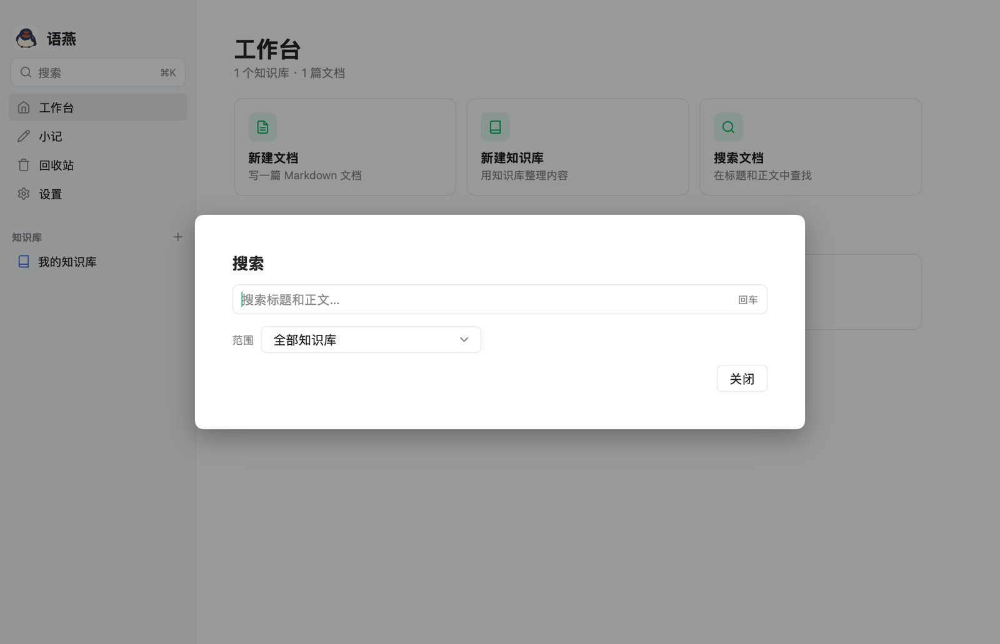

# 搜索

[返回教程目录](README.md) · [返回项目主页](../README.md)

当你记不清文档放在哪个目录时，用搜索。语燕会扫描知识库中的 Markdown 文件，在**标题和正文**中查找文字。

## 1. 打开搜索

有三种方式：

- 点击左侧侧栏顶部的「搜索」框；
- 按 `⌘K`（Windows/Linux 为 `Ctrl+K`）；
- 点击工作台的「搜索文档」卡片。

搜索窗口会覆盖在当前页面上方，输入框自动获得焦点。

## 2. 搜索步骤

1. 输入关键词；
2. 按 `Enter`，或等待输入后按回车；
3. 在「范围」中选择搜索范围；
4. 点击结果打开文档。

搜索是“包含匹配”：

- 英文不区分大小写；
- 中文按文字片段匹配，不做分词；
- 标题命中和正文命中都会返回；
- 空白字符会被规范化，连续空格不会影响结果。

> **提示**：搜索结果不会自动定位到正文中的匹配词，只会打开对应文档。打开后可以再用 `⌘F` 在当前文档内查找。

## 3. 搜索范围

「范围」下拉框提供：

- **全部知识库**：扫描文档目录中的全部内容，以及所有外部知识库。
- **某个知识库**：只扫描这个知识库。
- **当前资源：…**：只扫描当前选中的知识库、目录或文档。选中文档时，会包含它的子文档。

切换范围后会立即重新搜索当前关键词。

## 4. 结果说明

每条结果显示：

- 文档标题；
- 知识库内的相对路径；
- 正文中的一段摘要，匹配位置附近的内容会以省略号标出。

点击结果：

- 打开该文档；
- 关闭搜索窗口；
- 不改变搜索关键词，方便再次搜索。

如果没有匹配：

- 显示「没有找到匹配的文档」；
- 不会自动创建文档；
- 检查关键词、范围，或确认文件确实是 `.md`。

## 5. 搜索规则和限制

- **只搜索文档**：不会搜索图片、附件、回收站、小记或 `.swift/` 元数据。
- **最多 50 条结果**：超出后不会继续列出；请缩小范围或使用更具体的关键词。
- **没有索引**：每次搜索都会读取文件，因此知识库很大时可能需要一点时间；没有后台索引或缓存。
- **大小写**：英文不区分大小写；中文没有大小写概念。
- **不支持正则、模糊匹配、同义词**：只做普通文本包含匹配。
- **外部知识库也参与**：结果路径可能是外部知识库名称。
- **隐藏目录不参与**：以 `.` 开头的目录会被跳过。
- **不搜索小记**：小记保存到知识库后才会出现在结果中。

## 6. 搜索和查找的区别

| | 搜索 | 查找 |
| --- | --- | --- |
| 快捷键 | `⌘K` | `⌘F` |
| 范围 | 全部知识库 / 某个知识库 / 当前资源 | 当前文档 |
| 结果 | 文档列表 | 页面内高亮 |
| 替换 | 不支持 | 支持 |
| 适合 | 找文档 | 校对当前文档 |

## 7. 提高搜索命中率

- 用文档中确实出现过的词，而不是你记忆中的标题；
- 中文可以搜索两三个字的短语，过长反而容易漏；
- 先选知识库范围，再逐步扩大；
- 如果记得标题，优先搜标题中的词；
- 内容太多时，用更具体的组合词；
- 找不到时，检查文档是否被移动到了外部知识库，或是否还在回收站中。

## 8. 常见问题

**Q：为什么搜索不到刚写的内容？**

确认文档已经保存。语燕通常会在停止输入约 0.6 秒后保存；如果状态仍是「自动保存中…」，稍等再搜。

**Q：为什么搜索不到小记？**

小记不在知识库中，搜索不会扫描它。请先「保存到」知识库。

**Q：搜索结果为什么只有一个知识库？**

检查「范围」是否被限定到了某个知识库或当前资源。选择「全部知识库」。

**Q：能搜索回收站里的内容吗？**

不能。回收站是恢复区，不参与搜索；需要的话先还原文档。

**Q：能搜索附件内容吗？**

不能。附件只保存文件本身，语燕不会解析 PDF、Word 或图片中的文字。

## 下一步

- 找回删除的文档：[回收站](09-trash.md)
- 批量导入现有资料：[导入](10-import.md)
